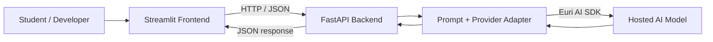

# CodeMentor AI 🧠

**An AI-powered coding tutor for learning programming concepts, reviewing source code, and generating educational examples.**

CodeMentor AI combines a **Streamlit** web interface with a **FastAPI** backend and the **Euri AI** Python SDK. It is designed as a small, understandable end-to-end AI application, with input validation, provider error handling, automated tests, and clear local setup instructions.

> **Project status:** Portfolio-ready source code for local development. Automated tests run without an API key; live AI responses require an Euri AI API key. This is an educational tool, not a code execution or formal verification system.

## Project motivation and scope

Programming learners often need three different kinds of support: understanding a concept, figuring out why their own code fails, and seeing a complete example they can adapt. CodeMentor AI brings those tasks into a single interface backed by focused prompts and a reusable REST API.

**Engineering focus:** connect a Python web UI to an API; validate language, skill-level, and code inputs; separate AI provider calls from application logic; handle missing credentials and provider failures; and test behavior without incurring AI API costs. The project integrates a hosted model; it **does not train or fine-tune a model** or run submitted code.

## Features

| Feature | What it does | Example |
| --- | --- | --- |
| **Concept explainer** | Breaks down programming ideas with code snippets, common mistakes, and practice exercises. | “Explain Python decorators to a beginner.” |
| **Code reviewer** | Analyzes *pasted source code* and optional error context, then suggests possible fixes. | Paste a function that raises `IndexError`. |
| **Code example generator** | Creates commented examples with usage instructions and limitations. | “Create a basic to-do list with Python classes.” |
| **Level-aware learning** | Adapts explanations and generated examples to Beginner, Intermediate, or Advanced users. | Beginner-friendly recursion walkthrough. |
| **Multi-language support** | Supports Python, JavaScript, Java, C++, Ruby, and Go. | Review a JavaScript promise chain. |

Additional engineering features: schema-based input validation, centralized AI provider adapter, local API health check, timeouts and clean error messages, mocked tests, and GitHub Actions CI.

## Architecture



**How a request flows:** (1) a user selects a language and enters a concept, code snippet, or task; (2) Streamlit sends validated inputs to the FastAPI endpoints; (3) the backend builds a task-specific prompt; (4) the Euri AI SDK calls a hosted model; (5) the result is displayed as Markdown and can be downloaded.

The backend does **not execute submitted code**, and the `/health` endpoint checks only the local API process, not the provider's live availability.

## Tech stack

| Layer | Technology |
| --- | --- |
| Frontend | Streamlit, Python |
| Backend | FastAPI, Pydantic |
| AI integration | Euri AI Python SDK (`euriai`), default model `gpt-4.1-nano` |
| HTTP requests | Requests |
| Configuration | python-dotenv, environment variables |
| Testing and quality | pytest, HTTPX, Ruff, GitHub Actions |

## Getting started

### Prerequisites

- Python **3.10+** and `pip`
- An **Euri AI API key** from [Euri AI](https://euron.one/euri)
- An internet connection for live AI calls

### 1. Clone and install

```bash
git clone https://github.com/abhishek-singh-dsai/codementor-ai.git
cd codementor-ai
python -m venv .venv
```

Activate the environment:

**Windows (PowerShell):**

```powershell
.venv\Scripts\Activate.ps1
```

**macOS / Linux:**

```bash
source .venv/bin/activate
```

Install the dependencies:

```bash
python -m pip install -r requirements.txt
```

> The clone command works after this repository is published. Before publication, extract the project archive and run the setup commands from the project root.

### 2. Configure environment variables

Copy `.env.example` to a local `.env` file (using your file explorer or command line), then edit it:

```dotenv
EURIAI_API_KEY=your_actual_api_key
EURIAI_MODEL=gpt-4.1-nano
API_BASE_URL=http://127.0.0.1:8000
```

Do **not** commit `.env` or share your API key. The repository ignores local environment files.

### 3. Start the backend

In your first terminal, from the project root:

```bash
python -m uvicorn main:app --reload
```

- API: <http://127.0.0.1:8000>
- Interactive API documentation: <http://127.0.0.1:8000/docs>
- Local health endpoint: <http://127.0.0.1:8000/health>

### 4. Start the frontend

Open a **second terminal** with the same virtual environment activated:

```bash
python -m streamlit run app.py
```

The Streamlit terminal shows the local URL (usually <http://localhost:8501>). Use the three tabs to explain a concept, review code, or generate a learning example.

## API endpoints

| Method | Endpoint | Purpose |
| --- | --- | --- |
| `GET` | `/` | API navigation |
| `GET` | `/health` | Local backend health check |
| `POST` | `/explain` | Explain a programming concept |
| `POST` | `/debug` | Analyze submitted source code |
| `POST` | `/generate` | Generate an educational code example |

**Explain a concept**

```bash
curl -X POST http://127.0.0.1:8000/explain \
  -H "Content-Type: application/json" \
  -d '{"language":"Python","topic":"list comprehensions","level":"Beginner"}'
```

**Review code**

```bash
curl -X POST http://127.0.0.1:8000/debug \
  -H "Content-Type: application/json" \
  -d '{"language":"Python","code":"print(unknown_variable)","context":"NameError"}'
```

**Generate an example**

```bash
curl -X POST http://127.0.0.1:8000/generate \
  -H "Content-Type: application/json" \
  -d '{"language":"Python","topic":"Create a simple stack class","level":"Intermediate"}'
```

Each successful AI request returns a JSON object with a `response` string. Invalid inputs return **422**, missing AI provider configuration returns **503**, and upstream provider failures return **502**. The accepted languages and skill levels are defined in `main.py` and visible in the Swagger API docs.

> These commands use Bash-compatible quoting. Windows PowerShell users can also test requests through the interactive `/docs` page.

## Project structure

```text
codementor-ai/
├── .github/workflows/ci.yml    # Multi-version automated tests + linting
├── .env.example                # Safe configuration template (no real keys)
├── .gitignore                  # Secrets, caches and virtual environments
├── ai_engine.py                # AI prompts and Euri AI SDK adapter
├── app.py                      # Streamlit web interface
├── main.py                     # FastAPI routes and request validation
├── notebooks/
│   └── euriai_quickstart.ipynb # Sanitized exploratory SDK notebook
├── tests/
│   ├── test_ai_engine.py       # Mock provider + prompt unit tests
│   └── test_api.py             # Endpoint contract and error tests
├── pyproject.toml              # Tool configuration
├── requirements.txt            # Runtime dependencies
├── requirements-dev.txt        # Test + lint dependencies
├── CONTRIBUTING.md
└── README.md
```

## Testing and code quality

Install development dependencies and run the checks:

```bash
python -m pip install -r requirements-dev.txt
python -m ruff check .
python -m pytest -q
```

Tests use **mocked AI provider responses** so you can run them without an Euri AI account, network access, or API billing. GitHub Actions runs linting and tests against multiple Python versions after repository pushes and pull requests.

**Important testing distinction:** passing these tests does not confirm that the Euri AI service or credentials work. Verify one end-to-end request manually with your own key before claiming a live deployment is operational.

## Design decisions and limitations

- **Separate frontend and backend:** UI changes do not require changing the AI provider code; endpoints can be used by other clients.
- **Centralized provider adapter:** prompts, SDK calls, response parsing, and upstream error handling are in one file.
- **Task-specific prompts:** learning, reviewing, and generating use different instructions and temperature settings.
- **Security-conscious defaults:** environment-based credentials; no hard-coded API keys; no raw upstream exception details returned to clients.
- **No code execution:** debugging is model-based static review only. Suggestions may be incomplete or incorrect.
- **Local-first, single-user prototype:** no authentication, persistent storage, rate limiting, production deployment, or usage-cost controls are included. Do not expose this backend publicly without adding those protections.
- **Privacy:** user prompts and pasted code are sent to the configured third-party AI service. Do not submit secrets, production credentials, or private code without authorization.

## Future improvements

- Syntax-highlighted editor and paste-friendly file upload (with file type/size controls)
- Sandboxed execution for *explicitly authorized* sample code (not part of the current implementation)
- More detailed model evaluation using a fixed set of programming questions
- Usage limits, authenticated access, and deployment configuration
- Screenshots or a short verified demonstration video

## Reference

Euri AI SDK: [PyPI — euriai](https://pypi.org/project/euriai/). This project uses the SDK's documented `EuriaiClient.generate_completion(...)` interface rather than embedding API credentials in source code.

---

*Built as a practical project exploring full-stack Python development, API design, and integration of hosted language models for programming education.*
